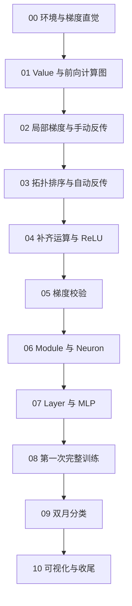

# tianyi-micrograd：从零手写 micrograd

本系列的目标是：你亲手实现一个标量自动求导引擎，再用自己写的神经网络完成训练，并能解释每一步的数值与梯度来自哪里。

参考项目是本机的 [micrograd](/data/ghs/projects/micrograd/README.md)。首版沿用 Python，默认使用 conda 的 `agent` 环境。教学方式参考 [TianLLama 的逐步实现文档](</data/ghs/TianLLama/docs/knowledge/第3课-算子%20%26%20Tensor/01-Tensor设计与基础语法.md>)：先解释问题和设计，再分段手写、验证，遇到 Python 语法时就地讲解。

## 1. 谁来写什么

- **你编辑全部源码、测试、示例和工程配置。**
- Agent 默认只编辑文档，执行只读探索，阅读你的代码并提供定位、解释和修改建议。
- 只有你明确授权修改代码时，Agent 才能修改被授权的范围。

文档中的“创建文件”“修改方法”“运行测试”都是交给你操作的步骤。文档提供代码示例，不表示 Agent 已经替你创建了对应文件。

## 2. micrograd 与 PyTorch 的关系

参考仓库中各部分的依赖不同：

| 部分         | 本机参考文件                                                       | 实际依赖与作用                                                              |
| ------------ | ------------------------------------------------------------------ | --------------------------------------------------------------------------- |
| 自动求导引擎 | [engine.py](/data/ghs/projects/micrograd/micrograd/engine.py)       | 使用 Python 对象、闭包、集合和递归，自己完成前向和反向传播                  |
| 神经网络层   | [nn.py](/data/ghs/projects/micrograd/micrograd/nn.py)               | 引入标准库`random` 和自己的 `Value`                                     |
| 原仓库测试   | [test_engine.py](/data/ghs/projects/micrograd/test/test_engine.py)  | 用 PyTorch 的结果检查 micrograd 的数值和梯度                                |
| 双月分类演示 | [demo.ipynb](/data/ghs/projects/micrograd/demo.ipynb)               | 用 NumPy、scikit-learn、Matplotlib 生成数据和画图；模型及求导使用 micrograd |
| 计算图绘制   | [trace_graph.ipynb](/data/ghs/projects/micrograd/trace_graph.ipynb) | 使用 Graphviz 展示已经建立的计算图                                          |

**实现和训练的核心不依赖 PyTorch。** 我们先用手算、解析导数和有限差分建立正确性，再把 PyTorch 作为可选的对照工具。`agent` 环境中装有 PyTorch，不意味着项目代码需要引入它。

本系列使用现有的 pytest 编写简短的测试；pytest 是开发时的测试工具，不参与自动求导或模型计算。

## 3. 学习顺序

先完成“一个表达式能算对梯度”，再完成“一个模型能学会数据”。不需要先学完整本 Python 教材。



| 课次                                                                          | 解决的问题                       | 完成时的证据                              | 文档状态     |
| ----------------------------------------------------------------------------- | -------------------------------- | ----------------------------------------- | ------------ |
| [00：学习准备与梯度直觉](./第00课-学习准备与梯度直觉.md)                       | 梯度是什么，如何独立检查它？     | 手算与有限差分得到同一组偏导数            | 已编写       |
| [00b：最小可编辑安装](./第00b课-最小可编辑安装.md)                             | 如何让环境直接找到自己的包？     | 不设置`PYTHONPATH` 也能导入自己的源码   | 已编写       |
| [01：Value 与前向计算图](./第01课-Value与前向计算图.md)                        | 数字如何变成带计算历史的节点？   | 加乘结果、父节点关系、对象身份的测试通过  | 已编写       |
| [02：局部梯度与手动反向传播](./第02课-局部梯度与手动反向传播.md)               | 一个运算如何把梯度传给输入？     | 手动调用局部反传，算对整条链及`x*x`     | 已编写       |
| [03：拓扑排序与自动反向传播](./第03课-拓扑排序与自动反向传播.md)               | 怎样自动决定反传顺序？           | `backward()` 算对链、共享节点和分叉汇合 | 已编写       |
| [04：幂运算、ReLU 与 Python 运算协议](./第04课-幂运算-ReLU与Python运算协议.md) | 怎样支持常见数学表达式？         | 幂、激活、负号、减除、左右混合运算通过    | 已编写       |
| [05：梯度校验与参考实现对齐](./第05课-梯度校验与参考实现对齐.md)               | 怎样知道引擎真的正确？           | 手算和有限差分检查通过，可选 PyTorch 对照 | 已编写       |
| [06：Module 与 Neuron](./第06课-Module与Neuron.md)                             | 如何把求导引擎组成一个神经元？   | 前向、参数枚举、清梯度和参数梯度通过      | 已编写       |
| [07：Layer 与 MLP](./第07课-Layer与MLP.md)                                     | 多个神经元如何组成网络？         | 输入输出约定、参数个数、最后一层行为通过  | 已编写       |
| [08：第一次完整训练](./第08课-第一次完整训练.md)                               | 梯度怎样帮助参数变好？           | 确定性的一元线性拟合中损失下降            | 已编写       |
| [09：双月分类与参考 demo 复现](./第09课-双月分类与参考demo复现.md)               | 一个非线性网络如何学习分类边界？ | 能解释损失、训练记录、准确率与决策边界    | 已编写       |
| [10：计算图可视化与项目收尾](./第10课-计算图可视化与项目收尾.md)               | 怎样检查与展示自己的实现？       | 读懂图中的数值和梯度，整理项目说明        | 已编写       |

“已编写”只表示教程存在。当前尚未据此确认你的源码或测试已经完成。第 09 课完成后，学习主线闭环；第 10 课的 Graphviz 可视化可以选做。

## 4. 目录与运行约定

保留现有 `src/`、`test/`，包名使用 `tianyi_micrograd`，避免和参考仓库或已安装的 `micrograd` 混淆。

下面是逐课演进的目标结构，**不要求现在一次建齐**：

```text
/data/ghs/projects/tianyi-micrograd/
├── pyproject.toml                  # 已手写，供可编辑安装使用
├── docs/
│   └── tutorials/                  # Agent 可以直接编辑的教学文档
├── src/
│   └── tianyi_micrograd/
│       ├── __init__.py             # 第 01 课手动创建
│       ├── engine.py               # 第 01～04 课实现，第 05 课校验
│       ├── nn.py                   # 第 06～07 课
│       └── visualize.py            # 第 10 课，Graphviz 可选
├── test/
│   └── tianyi_micrograd/
│       ├── test_value.py           # 已有前向测试
│       ├── test_manual_backward.py # 已有手动反传测试
│       ├── test_backward.py        # 第 03 课手动创建
│       ├── test_ops.py             # 第 04 课手动创建
│       ├── test_gradcheck.py       # 第 05 课主线校验
│       ├── test_engine_torch.py    # 第 05 课可选对照
│       ├── test_nn.py              # 第 06 课
│       ├── test_mlp.py             # 第 07 课
│       ├── test_training.py        # 第 08 课
│       ├── test_moons.py           # 第 09 课
│       └── test_visualize.py       # 第 10 课
└── examples/                       # 第 08 课开始手动创建
    ├── __init__.py
    ├── train_linear.py
    ├── moons_utils.py              # 第 09 课，实验与测试共用的函数
    ├── train_moons.ipynb           # 第 09 课，交互实验与内联图表
    └── draw_graph.py
```

当前已经编写 `pyproject.toml`，并在 `agent` 环境完成可编辑安装，可以直接导入自己的包。后续课程沿用现有配置，不再要求设置 `PYTHONPATH`；更换环境后，可按 [第 00b 课](./第00b课-最小可编辑安装.md) 检查安装。

统一在项目根目录执行：

```bash
conda activate agent
cd /data/ghs/projects/tianyi-micrograd
python -m pytest test -q
```

测试文件从第 01 课开始创建；还没有测试时，不需要先运行最后一条命令。不要为了导入自己的项目而安装 PyPI 上的 `micrograd`。

## 5. 每一课怎么学

1. 看“本课目标”和“需要修改的文件”，确认这次只增加哪些能力。
2. 先算一个有具体数值的小例子，写下预期结果。
3. 按小步骤手写实现，每一步理解后再继续。
4. 手写对应测试，先验证局部，再验证已有能力没有退步。
5. 用自己的话回答验收问题，通过后再进入下一课。

源码中的内容以你已经写出的版本为准。教程与当前实现不一致时，先让 Agent 读取现状，再调整下一步，避免整文件覆盖你的代码。

第 07～10 课各安排两个测试；第 09 课的数据检查、第 10 课的 Graphviz 检查在对应可选依赖缺失时跳过。第 09 课在 `examples/train_moons.ipynb` 中按单元格运行，内联查看数据、训练曲线和决策边界。训练、绘图和生成输出文件都由你手动运行，不在导入辅助模块时自动执行。

课程的具体拆分理由、各课验收点与文档格式见 [课程设计与协作约定](./课程设计与协作约定.md)。全部课程文档已编写，仍按实际实现进度逐课学习；教程齐全不代表源码、测试或演示已经完成。
