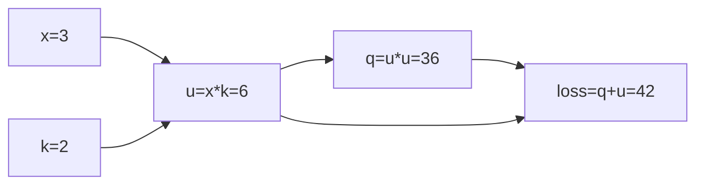

# 第 03 课：拓扑排序与自动反向传播

第 02 课已经让每个运算保存局部反传规则。你当前的引擎也已包含这些规则，但仍需要手动设置输出梯度、逐个调用 `_backward()`。

本课只增加一个 `backward()` 方法，让 `loss.backward()` 自动找到相关节点，安排顺序并执行反传。加乘的局部规则保持不变。

## 1. 本课修改哪里

以下文件由你手动编辑：

| 文件                                                                           | 操作                                |
| ------------------------------------------------------------------------------ | ----------------------------------- |
| `/data/ghs/projects/tianyi-micrograd/src/tianyi_micrograd/engine.py`         | 在`Value` 类中新增 `backward()` |
| `/data/ghs/projects/tianyi-micrograd/test/tianyi_micrograd/test_backward.py` | 新建文件，只写两个自动反传测试      |

保留已有的 `test_value.py` 和 `test_manual_backward.py`。手动反传测试和自动反传测试各自创建节点，可以独立运行。

继续使用 conda `agent` 环境与现有可编辑安装，不修改 `pyproject.toml`，不需要设置 `PYTHONPATH`：

```bash
conda activate agent
cd /data/ghs/projects/tianyi-micrograd
```

本课尚未支持普通数字混算，示例中的常数仍写成 `Value(2.0)`。

## 2. 为什么不能沿着图遇到谁就反传谁

第 02 课的简单链可以直接倒过来执行。但一个节点可能被后面的多个运算共同使用：

```python
x = Value(3.0)
k = Value(2.0)
u = x * k
q = u * u
loss = q + u
```

计算关系如下，箭头表示输入流向输出：



`u` 通过两条路径影响 `loss`：一条直接相加，另一条先经过平方。

手算结果为：

```text
dL/du = 2*u + 1 = 13
dL/dx = (dL/du)*(du/dx) = 13*2 = 26
```

反传必须先让 `loss`、`q` 都完成对 `u.grad` 的贡献，再调用 `u._backward()`。

如果从 `loss` 出发，遇到 `u` 就立即向前传播，此时可能只收到了直接相加的贡献 `1`，还没收到 `q` 带来的 `12`。即使给遍历加上去重，也不能解决“执行得太早”的问题。

我们需要一种顺序：**一个节点的所有下游运算先反传，它自己再反传。**

## 3. 拓扑排序：先找一份合法的前向顺序

把图中的节点排成一列，只要每个运算的输入都排在该运算之前，就是这里需要的拓扑顺序。

上面的图可以排成：

```text
拓扑顺序：x → k → u → q → loss
反传顺序：loss → q → u → k → x
```

把拓扑列表反过来，就满足刚才的反传要求。

`x` 和 `k` 互不依赖，谁排前面都可以。`_prev` 是集合，遍历顺序不固定，所以不要要求实际列表必须与上面逐项一致。需要保证的是依赖关系。

### 如何沿 _prev 构造这个列表

从最终输出开始，递归处理一个节点：

1. 如果已经访问过，直接返回。
2. 记录已经访问，避免共享节点被重复加入。
3. 先递归处理它的所有直接输入。
4. 最后把当前节点加入列表。

“先处理输入，最后加入自己”就是这里的后序遍历。正常前向运算总是新建结果节点，再引用已有输入，因此构成有向无环图，可以按这个关系排序。

## 4. 第一步：手写 backward 方法

在 `engine.py` 的同一个 `Value` 类中添加下面的方法。方法本身缩进 4 个空格，不要放进 `__mul__` 内部：

```python
    def backward(self):
        topo = []
        visited = set()

        def build_topo(node):
            if node in visited:
                return
            visited.add(node)
            for parent in node._prev:
                build_topo(parent)
            topo.append(node)

        build_topo(self)

        self.grad = 1
        for node in reversed(topo):
            node._backward()
```

这个方法分成两个阶段：先收集并排序，再执行反传。构造列表时不调用任何 `_backward()`。

整个 `backward` 方法分为三个核心步骤：**拓扑排序（构建计算图顺序）**、**初始化终点梯度**、以及**反向传播链式法则计算**。

#### 4.1 拓扑排序（Topology Sort）

在神经网络中，计算过程本质上是一个**有向无环图（DAG）**。比如 $L = (A + B) * C$，计算顺序是从前往后的（前向传播）。
但是求导（反向传播）必须**从后往前**进行：必须先计算输出结果 $L$ 的梯度，才能计算中间变量 $C$、$A$、$B$ 的梯度。

为了解决这个顺序问题，我们使用了**拓扑排序**算法：

```python
        topo = []
        visited = set()

        def build_topo(node):
            if node in visited:
                return
            visited.add(node)
            for parent in node._prev:  # _prev 记录了生成当前节点的上游节点
                build_topo(parent)
            topo.append(node)

        build_topo(self)
```

* **`visited = set()`**：用一个集合记录哪些节点已经被访问过了，防止在复杂的计算图中重复遍历同一个节点（比如某一个变量被用了多次）。
* **`build_topo(node)`**：这是一个递归函数。
  1. 如果节点访问过，直接返回。
  2. 没访问过，就先递归遍历它的所有“前置依赖节点”（`node._prev`）。
  3. 等它的所有前置节点都处理完了，才把当前节点放入 `topo` 列表。
* **`build_topo(self)`**：从当前调用 `backward()` 的根节点（输出结果）开始触发排序。

> **结果**：执行完这一步后，`topo` 列表里就按“先计算的在前面，后计算的在后面”的顺序排好了所有节点。

**本质：基于后序遍历思想的 DAG 拓扑排序算法（类似于多叉树的后序遍历思想。）**

#### 4.2 初始化输出节点的梯度

链式法则需要一个起点。微积分中，变量对自身的导数是 1 ($\frac{dL}{dL} = 1$)。

```python
        self.grad = 1
```

* `self` 就是调用 `backward()` 的那个最终输出变量（比如 Loss）。
* 我们把它的梯度 `grad` 设为 `1.0`。这是整个反向传播的“火种”。

---

#### 4.3 逆序执行反向传播

有了排好序的节点列表，又有了初始梯度，接下来就是顺着计算图反向推导了：

```python
        for node in reversed(topo):
            node._backward()
```

* **`reversed(topo)`**：因为 `topo` 是正向顺序（输入 $\rightarrow$ 输出），我们用 `reversed()` 将其翻转，变成**逆序**（输出 $\rightarrow$ 输入）。
* **`node._backward()`**：依次调用每个节点自己专属的微积分后向函数。这个函数会根据链式法则，把自己的梯度乘以局部导数，并累加到它的输入参数（`_prev`）的 `grad` 上去。

---

#### 4.4 总结思考

这段代码堪称整个微型自动求导引擎的点睛之笔：

1. **自动构建顺序**：用户不需要告诉程序先算哪个后算哪个，拓扑排序自动搞定。
2. **自动化链式法则**：通过逆序遍历 `topo` 并调用 `_backward()`，高阶复杂的复合函数求导被完美拆解成了简单的局部求导。

掌握了这段代码，你就真正理解了 PyTorch 等深度学习框架底层实现自动求导（Autograd）的核心思想！

## 5. 第二步：检查共享节点的梯度

手动创建 `/data/ghs/projects/tianyi-micrograd/test/tianyi_micrograd/test_backward.py`，将这个例子写成测试：

```python
from tianyi_micrograd.engine import Value


def test_backward_shared_node():
    x = Value(3.0)
    k = Value(2.0)
    u = x * k
    q = u * u
    loss = q + u
    loss.backward()

    assert loss.data == 42.0
    assert u.grad == 13.0
    assert x.grad == 26.0
```

在已激活的 `agent` 环境、项目根目录运行这个测试：

```bash
python -m pytest test/tianyi_micrograd/test_backward.py::test_backward_shared_node -q
```

通过时应显示 `1 passed`。三个断言分别检查前向结果、共享节点收齐的梯度和传给输入的梯度。

这一轮反传内部的关键变化是：

| 执行的局部规则       | 结果                                                |
| -------------------- | --------------------------------------------------- |
| `loss._backward()` | `q.grad=1`，`u.grad=1`                          |
| `q._backward()`    | 两个操作数都是`u`，各贡献 `6`，使 `u.grad=13` |
| `u._backward()`    | 使用已经收齐的`u.grad`，得到 `x.grad=26`        |

拓扑排序负责安排每个节点何时执行；乘法闭包负责重复操作数的两次贡献。这是两个不同的职责。

## 6. 第三步：补充链式测试

在同一个测试文件末尾追加下面的函数，不需要重复添加导入或共享节点测试：

```python
def test_backward_chain():
    a = Value(2.0)
    b = Value(-3.0)
    c = Value(10.0)
    f = Value(-2.0)
    loss = (a * b + c) * f
    loss.backward()

    assert loss.data == -8.0
    assert (a.grad, b.grad, c.grad, f.grad) == (6.0, -4.0, -2.0, 4.0)
```

这样本课仍然只有两个测试：第 5 节检查共享节点和重复操作数，本节确认自动调度与之前手动反传的结果一致。

先运行本课文件，再检查已有测试：

```bash
python -m pytest test/tianyi_micrograd/test_backward.py -q
python -m pytest test -q
```

本课文件应显示 `2 passed`。全部测试的数量取决于你保留的文件，以实际运行结果为准。

## 7. 本课的梯度使用约定

`backward()` 每次新建排序列表，但不会自动清空整张图的梯度，只把最终输出的 `grad` 设为 `1`。其他节点继续使用 `+=`。

因此，本课每次实验都重新创建整张图，不要先手动反传、又对同一张图调用自动反传。重复使用旧图会受到中间节点残留梯度的影响，不能简单认为第二次只把叶节点梯度翻倍。

后面的训练会每轮重新前向建立中间节点，并在反传前清空被复用的模型参数梯度。现在暂不增加自动清梯度机制。

从前向到反传结束，也继续保持节点 `.data` 不变，避免局部规则读取到与这次前向不一致的数值。

## 8. 常见问题与验收

| 现象                     | 优先检查                                               |
| ------------------------ | ------------------------------------------------------ |
| 链能算对，共享节点算不对 | 是否先排序再执行；是否在递归完成后才`append`         |
| 共享节点梯度过大         | 是否缺少`visited`，让同一个节点反传多次              |
| 梯度全是零               | 是否设置根节点的`grad=1`；是否调用了反向列表         |
| 看起来只执行了最后一步   | 是否误调用`_backward()`，而不是新增的 `backward()` |
| 多次运行实验结果不同     | 是否重复使用旧节点；不要依赖`_prev` 的具体遍历顺序   |

完成后回答：为什么 `u` 只执行一次反传，却能收到 `13` 的梯度？为什么仅仅去重、却不保证执行顺序仍然不够？

参考阅读：[原版 backward](/data/ghs/projects/micrograd/micrograd/engine.py:54)。下一课进入 [幂运算、ReLU 与 Python 运算协议](./第04课-幂运算-ReLU与Python运算协议.md)。
