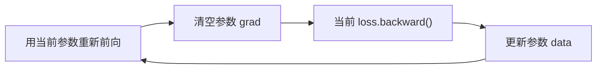

# 第 08 课：第一次完整训练

前面已经检查了网络的前向、梯度与参数管理。本课让参数真正发生变化：用一个线性神经元拟合 `y=2*x+1`。

先选择只有两个参数的小模型，可以手算初始梯度和第一次更新。训练的核心只使用自己的引擎与 Python 标准库，不需要 PyTorch、NumPy 或优化器。

## 1. 本课创建哪些文件

由你手动创建：

| 文件 | 内容 |
| --- | --- |
| `/data/ghs/projects/tianyi-micrograd/examples/__init__.py` | 空文件，将示例目录标记为包 |
| `/data/ghs/projects/tianyi-micrograd/examples/train_linear.py` | 数据、损失、训练函数和运行入口 |
| `/data/ghs/projects/tianyi-micrograd/test/tianyi_micrograd/test_training.py` | 两个测试 |

如果 `examples/__init__.py` 已存在，就保留它。无需修改引擎、网络类或 `pyproject.toml`。示例从项目根目录以模块形式运行，测试也可以直接导入其中的函数。

```bash
conda activate agent
cd /data/ghs/projects/tianyi-micrograd
```

开始前，第 06、07 课的测试应当已由你运行确认。虽然本课只用 `Neuron`，完整 MLP 的训练流程也是同一套。

## 2. 先手算初始损失和梯度

三个样本固定为：

| x | 目标 y |
| ---: | ---: |
| -1 | -1 |
| 0 | 1 |
| 1 | 3 |

模型为 `prediction=w*x+b`，关闭 ReLU，令 `w=b=0`。三个预测全为零。

使用均方误差 MSE：

```text
L = [(prediction0-y0)**2 + (prediction1-y1)**2 + (prediction2-y2)**2] / 3
```

代入零参数，初始损失为 `(1+1+9)/3=11/3`。

对每个样本，平方误差的导数为 `2*(prediction-y)`，所以：

```text
dL/dw = (2/3) * Σ[(w*x+b-y)*x] = -8/3
dL/db = (2/3) * Σ[ w*x+b-y   ] = -2
```

以学习率 `0.1` 做梯度下降：

```text
w_new = w - 0.1*dw = 4/15
b_new = b - 0.1*db = 1/5
```

参数沿梯度的反方向移动，第一次更新后损失为 `1784/675≈2.642963`，低于 `11/3≈3.666667`。

## 3. 第一步：固定数据和初始参数

手动创建 `train_linear.py`，先写入：

```python
from tianyi_micrograd.nn import Neuron


DATA = [(-1.0, -1.0), (0.0, 1.0), (1.0, 3.0)]


def build_model():
    model = Neuron(1, nonlin=False)
    model.w[0].data = 0.0
    model.b.data = 0.0
    return model
```

虽然构造函数会生成随机权重，这里在前向之前立即设为零，整个实验不依赖随机种子。

本课使用线性输出，因为目标里有负数。把 ReLU 放在输出端，会让这个神经元无法拟合 `x=-1` 对应的 `y=-1`。

## 4. 第二步：把误差组成一个标量损失

在同一个文件顶层追加：

```python
def mean_squared_error(model, data):
    errors = [(model([x]) - y)**2 for x, y in data]
    return sum(errors) / len(errors)
```

这里约定 `data` 非空。每次调用都会重新执行模型，产生新的预测、误差与损失节点。三个样本共用同一组参数，反传时各样本对参数的贡献会累加，再乘上平均系数 `1/3`。

损失必须保持为 `Value`。如果提前使用 `model([x]).data` 计算误差，后续就只剩普通浮点数，计算图断开了。

`.data` 适合记录指标和修改参数值，不适合替代需要求导的中间运算。

## 5. 第三步：写训练循环

继续在文件顶层追加：

```python
def train(steps=100, learning_rate=0.1):
    model = build_model()
    history = []

    for step in range(steps):
        loss = mean_squared_error(model, DATA)
        history.append(loss.data)

        model.zero_grad()
        loss.backward()
        for parameter in model.parameters():
            parameter.data -= learning_rate * parameter.grad

    history.append(mean_squared_error(model, DATA).data)
    return model, history
```

每一轮都有四个动作：



逐项理解：

1. **重新前向**：参数在上一轮已改变，要为新参数建立新的中间图。
2. **清梯度**：权重与偏置对象跨轮复用，它们的 `.grad` 不会自动清零。
3. **反传**：只对本轮新建的损失调用一次 `backward()`。
4. **更新数值**：修改原参数对象的 `.data`，让下一轮前向使用新值。

清梯度放在本轮前向之前也可以，这里统一放在前向之后、反传之前。它只操作 `.grad`，不会改变本轮前向的数值。

### 为什么更新的是 parameter.data

`parameter.data -= learning_rate*parameter.grad` 在普通数值上运算，不会把优化过程接入计算图。

不要写 `parameter = parameter-learning_rate*parameter.grad`。那只是让循环变量指向一个新节点，模型持有的原参数并没有被替换，而且还额外建立了计算图。

也不要在前向与反传之间修改参数 `.data`。本项目的局部反传会读取输入的数值，这样会让本轮导数与前向不一致。

### history 记录的是哪个时刻

循环里的 `loss` 是本轮更新前的损失。更新参数不会自动重算这个旧节点的 `.data`。

所以循环结束后再前向一次，记录最终参数对应的损失。100 次更新会得到 101 个普通数值：`history[0]` 是初始损失，`history[-1]` 是最后一次更新后的损失。

只存普通数值，也避免为了日志把每一轮的整张旧图都留在列表里。

## 6. 第四步：添加运行入口

在文件末尾追加：

```python
def main():
    model, history = train()
    print(f"initial loss: {history[0]:.6e}")
    print(f"final loss:   {history[-1]:.6e}")
    print(f"w={model.w[0].data:.6f}, b={model.b.data:.6f}")
    for x, target in DATA:
        prediction = model([x]).data
        print(f"x={x:+.1f}, target={target:+.1f}, prediction={prediction:+.6f}")


if __name__ == "__main__":
    main()
```

`if __name__ == "__main__"` 让训练只在你运行这个模块时开始。测试导入函数时，不会顺便启动训练或打印日志。

手动运行：

```bash
python -m examples.train_linear
```

应看到初始损失约 `3.666667`，最终损失小于 `1e-10`，`w` 接近 `2`、`b` 接近 `1`，三个预测分别接近 `-1、1、3`。这些阈值针对上面固定数据、100 步与学习率 `0.1`，不代表所有训练任务都有相同结果。

## 7. 第五步：用两个测试确认训练

手动创建 `test_training.py`，写入下面两个测试：

```python
from math import isclose

from examples.train_linear import DATA, build_model, mean_squared_error, train


def test_first_step():
    model = build_model()
    loss = mean_squared_error(model, DATA)
    model.zero_grad()
    loss.backward()

    assert isclose(loss.data, 11 / 3)
    assert isclose(model.w[0].grad, -8 / 3)
    assert isclose(model.b.grad, -2)

    for p in model.parameters():
        p.data -= 0.1 * p.grad
    assert isclose(model.w[0].data, 4 / 15)
    assert isclose(model.b.data, 1 / 5)
    assert isclose(mean_squared_error(model, DATA).data, 1784 / 675)


def test_training_converges():
    model, history = train(steps=100, learning_rate=0.1)
    assert len(history) == 101
    assert isclose(history[0], 11 / 3)
    assert history[-1] < 1e-10
    assert isclose(model.w[0].data, 2.0, rel_tol=0, abs_tol=2e-6)
    assert isclose(model.b.data, 1.0, rel_tol=0, abs_tol=2e-6)
```

第一个测试对照独立手算，检查初始梯度和一次更新；第二个检查多轮训练确实更新了模型，且每轮没有错误累积梯度。

因为包含除以 3 等浮点计算，使用 `isclose`。参数最终接近目标即可，无需要求恰好等于 `2`、`1`。

运行：

```bash
python -m pytest test/tianyi_micrograd/test_training.py -q
python -m pytest test -q
```

新文件应为 `2 passed`。这仍需要你实际运行确认，不能仅凭教程中的预期判断项目已经通过。

## 8. 为什么这个小例子能稳定收敛

利用三个输入的平均值为零、平方平均值为 `2/3`，可以把损失写成：

```text
L = (2/3)*(w-2)**2 + (b-1)**2
```

因此学习率为 `0.1` 时，每次更新后：

```text
w_new-2 = (13/15)*(w-2)
b_new-1 = (4/5)*(b-1)
```

两个误差都按小于 1 的正系数缩小。这解释了当前设置下的收敛，也让我们不必靠观察日志猜测结果。

一般网络的训练不保证每一步损失下降；这里的行为来自这个特定的二次函数和学习率。

## 9. 常见问题与验收

| 现象 | 优先检查 |
| --- | --- |
| 初始损失不是 11/3 | 数据、零初始化、是否取平均、是否关闭 ReLU |
| 第一次梯度正负相反 | 平方误差与目标的关系、更新是否沿负梯度 |
| 第一轮正确，后面越来越乱 | 是否每轮清参数梯度，并重新计算损失 |
| 局部变量变了，模型权重没变 | 是否更新了 `.data`，而非重新绑定循环变量 |
| 打印的最终损失与预测不符 | 是否拿更新前的旧损失当作最终损失 |
| 损失是普通 float，没有 backward | 是否提前取了预测的 `.data` |

验收时说明：为什么三个样本共享参数会得到平均梯度；为什么每轮要同时清参数梯度、重新建图；为什么一次更新后的损失必须重新前向才能得到。

通过后进入 [第 09 课：双月分类与参考 demo 复现](./第09课-双月分类与参考demo复现.md)。
