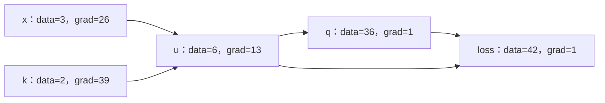

# 第 10 课：计算图可视化与项目收尾

本课回到一个只有几个节点的表达式，把数值、梯度和连接关系一起展示出来，再整理项目的运行方式与支持范围。

先实现不需要外部依赖的文本查看；愿意绘图时再使用 Graphviz。可视化不改变自动求导流程，也不是完成前面训练主线的前提。

## 1. 本课创建和整理哪些文件

以下都由你手动编辑：

| 文件                                                                            | 操作                                    |
| ------------------------------------------------------------------------------- | --------------------------------------- |
| `/data/ghs/projects/tianyi-micrograd/src/tianyi_micrograd/visualize.py`       | 新建，图遍历、文本显示、可选绘图        |
| `/data/ghs/projects/tianyi-micrograd/examples/draw_graph.py`                  | 新建，小图的运行入口                    |
| `/data/ghs/projects/tianyi-micrograd/test/tianyi_micrograd/test_visualize.py` | 新建，两个测试                          |
| `/data/ghs/projects/tianyi-micrograd/READEME.md`                              | 整理项目说明，或由你统一为`README.md` |

根目录目前的说明文件名是 `READEME.md`，拼写如此。你可以先在现有文件里整理；若决定改为常见的 `README.md`，再自行重命名并调整相关引用，不必维护两份内容。

沿用现有可编辑安装与 `examples/__init__.py`：

```bash
conda activate agent
cd /data/ghs/projects/tianyi-micrograd
```

本课不要求修改 `engine.py` 或 `nn.py`，也不需要重新设计打包配置。

## 2. 先知道这张图应当长什么样

选择第 03 课的共享节点例子：

```text
x = 3
k = 2
u = x*k = 6
q = u*u = 36
loss = q+u = 42
```



从输出往回看：`loss.grad=1`，加法给 `q`、`u` 各贡献 `1`；平方再给 `u` 贡献 `2*u=12`，所以 `u.grad=13`。

最后经过 `u=x*k`：`x.grad=13*2=26`，`k.grad=13*3=39`。

这里图上只有一条 `u → q` 连接，因为 `_prev` 是集合。它表示依赖关系，不记录同一个输入出现了几次；`q` 的乘法闭包仍会贡献两次梯度。

## 3. 第一步：只遍历图，不执行反传

手动创建 `visualize.py`，先写入：

```python
def trace(root):
    nodes, edges = set(), set()

    def build(node):
        if node in nodes:
            return
        nodes.add(node)
        for parent in node._prev:
            edges.add((parent, node))
            build(parent)

    build(root)
    return nodes, edges
```

`nodes` 保存节点对象，兼作访问记录；`edges` 保存 `(输入节点,结果节点)`，箭头方向与前向计算一致。

它和 `backward()` 都沿 `_prev` 查找依赖，但用途不同：这里仅收集连接关系，不修改梯度，也不安排反传顺序。因此不需要构造拓扑列表。

两个数值相等的 `Value` 仍然是两个对象。图的节点身份应当按对象区分，不能用 `node.data` 当唯一标识。

## 4. 第二步：生成可阅读的文本

在同一个文件顶层追加：

```python
def format_graph(root):
    nodes, _ = trace(root)
    lines = []
    for node in sorted(nodes, key=id):
        inputs = ", ".join(str(id(p)) for p in sorted(node._prev, key=id))
        lines.append(
            f"{id(node)}: data={node.data:.4f} grad={node.grad:.4f} "
            f"op={node._op or 'leaf'} inputs=[{inputs}]"
        )
    return "\n".join(lines)
```

`id()` 是对象在本次运行中的身份标识。`sorted(...,key=id)` 让一次显示中的排序有明确规则，但它不是拓扑顺序，换次运行也不保证 ID 与行顺序相同。

每行包含节点的身份、数值、梯度、运算和直接输入身份。没有 `_op` 的节点显示为 `leaf`，输入列表为空。

请通过 `inputs` 中的 ID 查连接，不要把文本的上下行顺序当作反传顺序。`format_graph()` 返回字符串，由调用方决定是否打印。

## 5. 第三步：增加可选的 Graphviz 绘图

继续在文件顶层追加：

```python
def draw_dot(root):
    from graphviz import Digraph

    nodes, edges = trace(root)
    dot = Digraph(format="svg", graph_attr={"rankdir": "LR"})

    for node in sorted(nodes, key=id):
        uid = str(id(node))
        label = f"{{data {node.data:.4f} | grad {node.grad:.4f}}}"
        dot.node(uid, label=label, shape="record")
        if node._op:
            op_uid = f"op_{uid}"
            dot.node(op_uid, label=node._op)
            dot.edge(op_uid, uid)

    for parent, node in sorted(edges, key=lambda edge: (id(edge[0]), id(edge[1]))):
        dot.edge(str(id(parent)), f"op_{id(node)}")

    return dot
```

`graphviz` 只在调用这个函数时导入，缺少它不影响 `trace()`、文本查看或核心引擎。

图里有两种显示元素：

| 显示元素 | 作用                                 |
| -------- | ------------------------------------ |
| 方框     | 一个真正的`Value`，显示数值与梯度  |
| 运算符   | 当前结果的`_op`，例如 `+`、`*` |

每次运算画成 `输入 Value → 运算符 → 结果 Value`。运算符只是绘图元素，不是新增的求导节点。

`rankdir="LR"` 让图从左到右排列；`shape="record"` 将数值、梯度分栏。f-string 里的 `{{`、`}}` 表示输出字面的花括号，提供给 Graphviz 的 record 标签。

`lambda edge: ...` 为边排序提供一个小函数；排序只让输出更容易查看，不改变图的含义。

这个实现依赖正常计算图的约定：有输入的结果节点带有 `_op`。直接使用现有加乘、幂和 ReLU 建立的图满足这个条件。

### Python 包与系统程序是两项依赖

| 操作                                | 需要什么                          |
| ----------------------------------- | --------------------------------- |
| `trace()`、`format_graph()`     | 自己的代码与 Python               |
| `draw_dot()`、查看 `dot.source` | Python 的`graphviz` 包          |
| `dot.render()` 生成 SVG           | Python 包，加上系统的`dot` 程序 |

编写本课时，`agent` 环境未安装 Python `graphviz` 包，但系统已有 `/usr/bin/dot`。你选择绘图时，可先检查，再按需手动安装 Python 包：

```bash
python -m pip show graphviz
dot -V
```

Python 包缺失时，可手动执行 `python -m pip install graphviz`。如果换机器后缺少系统 `dot`，还需要单独准备 Graphviz 程序；仅安装 Python 包不能提供渲染程序。

## 6. 第四步：写一个小图运行入口

手动创建 `examples/draw_graph.py`，写入：

```python
import sys
from pathlib import Path

from tianyi_micrograd.engine import Value
from tianyi_micrograd.visualize import draw_dot, format_graph


def main(render=False):
    x = Value(3.0)
    k = Value(2.0)
    u = x * k
    loss = u * u + u
    loss.backward()
    print(format_graph(loss))

    if render:
        Path("outputs").mkdir(exist_ok=True)
        path = draw_dot(loss).render(filename="graph", directory="outputs", cleanup=True)
        print(f"saved: {path}")


if __name__ == "__main__":
    main(render="--render" in sys.argv[1:])
```

`sys.argv[1:]` 是模块名之后的命令行参数。这里仅判断有没有 `--render`，没有增加完整的命令行框架。

先手动查看文本，不需要 Graphviz：

```bash
python -m examples.draw_graph
```

应看到五个节点，数值和梯度与第 2 节一致。ID 每次会变，不要求逐字匹配输出。

愿意绘图且依赖齐全时，再运行：

```bash
python -m examples.draw_graph --render
```

这时生成 `/data/ghs/projects/tianyi-micrograd/outputs/graph.svg`。`cleanup=True` 清理渲染时产生的 DOT 源文件，保留 SVG；它不删除模型或计算图。

注意先 `loss.backward()`、后绘图，才能看到本次反传后的梯度。如果先创建 `dot`、再反传，已生成的标签字符串不会自动更新，需要重新调用 `draw_dot()`。

## 7. 第五步：用两个测试检查图

手动创建 `test_visualize.py`，写入：

```python
import pytest

from tianyi_micrograd.engine import Value
from tianyi_micrograd.visualize import draw_dot, format_graph, trace


def test_trace_shared_node():
    x, k = Value(3.0), Value(2.0)
    u = x * k
    q = u * u
    loss = q + u
    loss.backward()

    nodes, edges = trace(loss)
    assert nodes == {x, k, u, q, loss}
    assert edges == {(x, u), (k, u), (u, q), (q, loss), (u, loss)}
    assert (u.grad, x.grad, k.grad) == (13, 26, 39)
    text = format_graph(loss)
    assert len(text.splitlines()) == 5
    assert f"{id(u)}: data=6.0000 grad=13.0000" in text


def test_draw_dot():
    pytest.importorskip("graphviz")
    x = Value(3.0)
    u = x * 2
    q = u * u
    loss = q + u
    loss.backward()

    source = draw_dot(loss).source
    assert "data 42.0000 | grad 1.0000" in source
    assert source.count(f"{id(u)} -> op_{id(q)}") == 1
```

第一个测试检查完整的节点、边集合和共享节点梯度，完全不依赖 Graphviz。第二个只检查 DOT 描述，不调用系统程序，也不产生输出文件。

```bash
python -m pytest test/tianyi_micrograd/test_visualize.py -q
python -m pytest test -q
```

未安装 Python `graphviz` 包时，新文件应为 `1 passed, 1 skipped`；已安装时应为 `2 passed`。系统 `dot` 是否可用，由你实际运行 `--render` 检查。

## 8. 第六步：整理项目说明

在根目录的说明文件中，用你自己的话写清以下内容。这里是整理提纲，不表示这些步骤已经由你完成：

| 项目       | 建议写明                                                                    |
| ---------- | --------------------------------------------------------------------------- |
| 目标       | 从零实现 Python 标量自动求导，用自己的模型完成训练                          |
| 核心文件   | `engine.py`、`nn.py`，可视化是独立可选模块                              |
| 环境与安装 | conda`agent`，已有 `pyproject.toml` 和可编辑安装方式                    |
| 测试       | 从项目根目录运行`python -m pytest test -q`                                |
| 示例       | 线性拟合、双月分类 Notebook 的打开与单元格运行方式、文本图与可选 SVG 的命令 |
| 依赖       | 核心、测试、数据绘图、可选对照和 Graphviz 分开说明                          |
| 学习结果   | 记录自己实际运行的指标、测试结果与图片                                      |
| 参考来源   | 本机 micrograd 对应的上游来源及许可证                                       |

沿用 [第 00b 课](./第00b课-最小可编辑安装.md) 的安装步骤；换环境时由你运行 `python -m pip install -e . --no-build-isolation`。本课不要求发布包、上传制品或增加发布配置。

如果保留了参考实现的代码或其重要部分，在复制、分发时保留参考仓库 [LICENSE](/data/ghs/projects/micrograd/LICENSE) 中的版权和许可声明。相关说明或许可证文件由你整理，本课不代替你创建。

### 第一版支持范围

可以在说明里明确记录：

- 一个 `Value` 表示一个标量，支持加乘、常量指数幂、ReLU，以及由已有运算组成的负号、减除和左右混合运算。
- `backward()` 对一个标量输出求导；训练每轮重新前向，并清空被复用参数的梯度。
- `Module`、`Neuron`、`Layer`、`MLP` 组合出小型全连接网络；最后一层线性输出。
- 输入长度必须匹配；采用参考接口时，宽度为 1 的层只放在末尾。
- 不包含 Tensor、广播、GPU 或完整优化器框架；ReLU 零点梯度按约定取零。
- 幂与除法使用课程中约定的定义域；当前幂反传公式对 `Value(0)**0` 也不作通用支持。

这些边界能帮助以后阅读项目的人理解接口，避免把教学用标量引擎当作完整数值库。

## 9. 常见问题与最终验收

| 现象                       | 优先检查                                     |
| -------------------------- | -------------------------------------------- |
| 文本图重复显示共享节点     | 是否按节点对象去重                           |
| 数值相同的节点被合并了     | 是否错误地用`.data` 作为节点身份           |
| `u*u` 图上只有一条输入边 | 这是集合去重；乘法反传仍应贡献两次           |
| 图里全是零梯度             | 是否已经反传，是否重新生成了图标签           |
| 能生成 DOT，不能生成 SVG   | Python 包与系统`dot` 是否都可用            |
| 大网络图挤成一团           | 先画小表达式或单神经元，不直接画整轮分类损失 |

最后由你重新运行已有测试、线性训练，以及已选择的分类和绘图示例，记录实际结果。可选依赖缺失时，写清跳过了哪一项，不把跳过当作功能已经验证。

试着不看源码，完整讲一遍：

一次 `a*b+c` 怎样创建节点、连接输入并保存局部反传闭包？

为什么共享节点需要梯度累加，为什么还需要逆拓扑顺序？

神经元怎样把参数组成表达式，网络怎样收集到原参数对象？

每轮训练为什么重新建图、清梯度，为什么只更新参数 `.data`？

怎样用手算、有限差分、训练记录和小图分别检查不同的问题？

能够解释并验证这些问题，就完成了这套手写 micrograd 的学习主线。以后要扩展输入检查、统一返回类型或参数保存时，先明确一个小目标，再增加对应示例与必要测试。

参考：[原版计算图演示](/data/ghs/projects/micrograd/trace_graph.ipynb)。返回 [课程目录](./README.md)。
